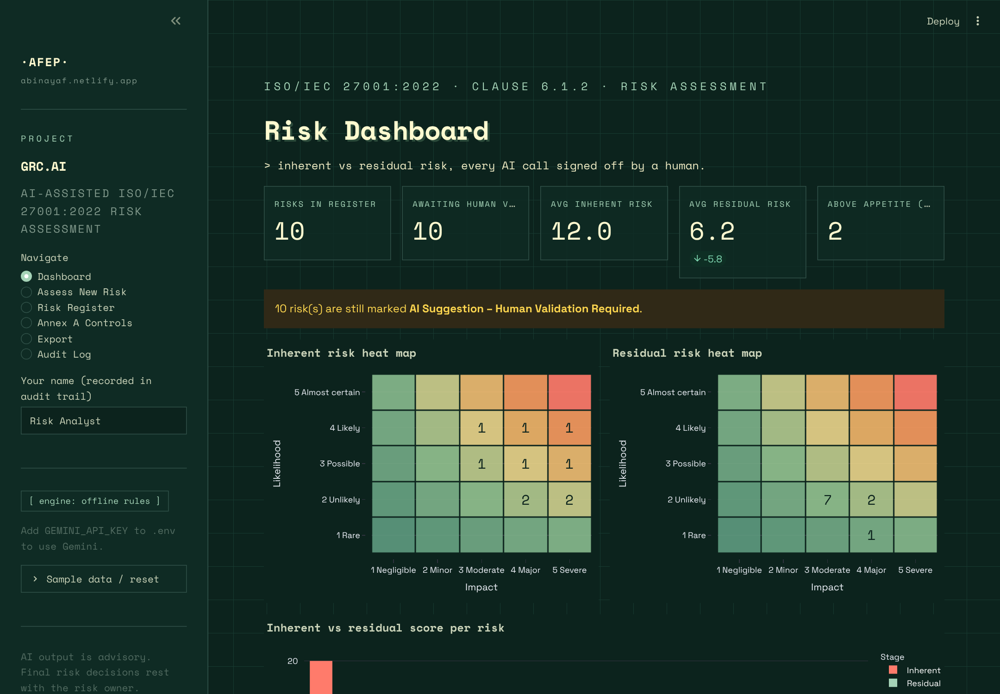
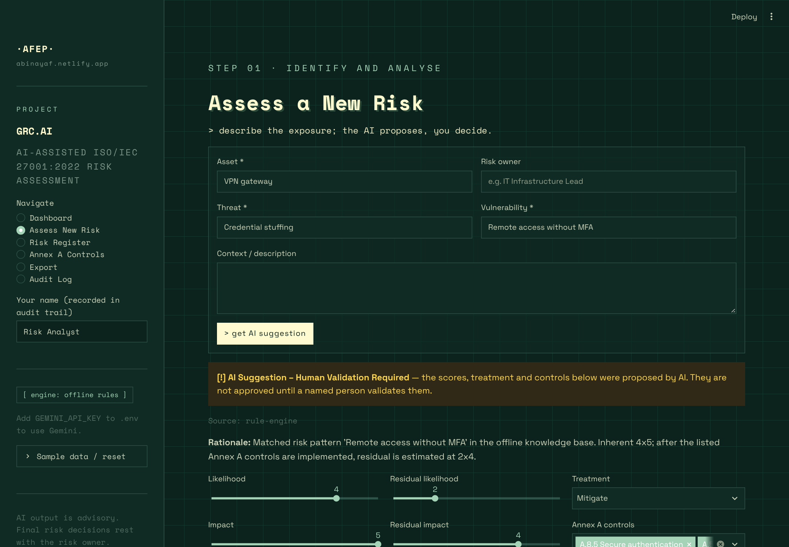

# GRC.AI – AI-Assisted ISO/IEC 27001:2022 Risk Assessment Tool

A Python/Streamlit risk register in which **Google Gemini proposes risk scores, treatments and
Annex A controls** for exposures such as *remote access without MFA* and *stale accounts after
offboarding*. Every AI output is flagged **"AI Suggestion – Human Validation Required"** and is
only approved once a named person validates it.

  





## Features
- **AI risk suggestions** – likelihood, impact, treatment (Mitigate/Accept/Transfer/Avoid),
  2–6 Annex A controls, treatment plan and residual score.
- **Works offline** – with no `GEMINI_API_KEY` a built-in rule engine (11 risk patterns) is used;
  if Gemini fails, the tool falls back automatically.
- **Guard-rails on AI output** – scores clamped to 1–5, unknown control numbers discarded,
  residual can never exceed inherent.
- **Human-in-the-loop** – AI rows stay "AI Suggestion – Human Validation Required" until a
  named validator approves or rejects them.
- **Full ISO/IEC 27001:2022 Annex A catalogue** – all 93 controls across 4 themes.
- **SQLite persistence** with a tamper-evident style **audit log** of every action.
- **Plotly dashboards** – inherent vs residual heat maps, per-risk comparison, rating mix.
- **Audit-ready export** – Excel workbook (Summary, Risk Register, Statement of Applicability,
  Audit Log) and CSV.

## Sample run
`python seed_sample.py --validate` loads 10 university risks:

| Metric | Value |
|---|---|
| Average inherent risk | **12.0** |
| Average residual risk | **6.2** |

## Quick start (Windows)
```powershell
py -3.12 -m venv venv
.\venv\Scripts\Activate.ps1
pip install -r requirements.txt
python seed_sample.py            # optional sample data
streamlit run app.py
```
Optional: copy `.env.example` to `.env` and add a Gemini API key.

## Tests
```powershell
python -m pytest -v
```
14 tests cover scoring, the rule engine, Gemini guard-rails (mocked), validation workflow,
audit logging, exports and every Streamlit page.

## Project structure
```
app.py               Streamlit UI (dashboard, assess, register, controls, export, audit)
seed_sample.py       Loads the 10-risk sample run
grc/ai_engine.py     Gemini + offline rule engine + output guard-rails
grc/controls.py      ISO/IEC 27001:2022 Annex A (93 controls)
grc/db.py            SQLite register and audit trail
grc/export.py        Excel / CSV export incl. Statement of Applicability
grc/scoring.py       5x5 likelihood x impact methodology
tests/               pytest suite
```

## Disclaimer
AI output is advisory. Final risk acceptance rests with the risk owner and management.

## Design
Dashboards and reports share the **·AFEP·** visual identity (dark-green terminal aesthetic, Space Mono + Space Grotesk, bundled offline in `static/fonts` under the SIL Open Font License) defined in `afep_theme.py`.

---
**·AFEP·** Built by **Abinaya Francisca E P** · [abinayaf.netlify.app](https://abinayaf.netlify.app)
